<picture>
  <source media="(prefers-color-scheme: dark)" srcset="assets/header-dark.svg">
  
</picture>

**[Now](#now)** · **[Built](#built)** · **[Writing](#writing)** · **[Elsewhere](#elsewhere)**

Senior AI/ML Engineer at [Express Analytics](https://expressanalytics.com), in the UAE. I spend most of my time on the harness and evals around agents, because that is where their reliability comes from.

## Now

- **[kAInet](https://expressanalytics.com/agentic-ai)** · agents that plan Google and Meta ad campaigns with marketers, and launch them
- **[Vara](https://vara.ajmalaksar.com)** · a whiteboard you talk to, in five languages
- **[Zawaaj](https://zawaaj.in)** · invitations for weddings with many events

## Built

- **[gsab](https://github.com/ajmalaksar25/gsab)** · Google Sheets as a backend, with an MCP server for agents. On [PyPI](https://pypi.org/project/gsab/).
- **[Claude Usage Dashboard](https://github.com/ajmalaksar25/claude-usage-dashboard)** · what your Claude Code usage would cost at API rates, worked out on your machine
- **[Searchlight](https://github.com/ajmalaksar25/searchlight)** · an SEO agent that fixes your site and checks the fix is live. Still in progress.
- **[skills](https://github.com/ajmalaksar25/skills)** · my agent skills, as plain `SKILL.md` files
- **[kNavigate](https://github.com/ajmalaksar25/kNavigate)** · an offline GPS audio tour of the Karunya campus

## Writing

- **[One WER number hides everything](https://ajmalaksar.vercel.app/blog/one-wer-number-hides-everything)** · zero errors in the eval, and an empty board in one language
- **[The 504 that was never a timeout](https://ajmalaksar.vercel.app/blog/the-504-that-was-never-a-timeout)** · four 504s, not seventy-five, and the cause was my own code
- **[82 finals for 41 utterances](https://ajmalaksar.vercel.app/blog/82-finals-for-41-utterances)** · a double click that started two transcribers
- **[I talk to my computer](https://ajmalaksar.vercel.app/blog/i-talk-to-my-computer-613k-words)** · 613k dictated words, counted

More on [my blog](https://ajmalaksar.vercel.app/blog).

## Elsewhere

[Website](https://ajmalaksar.vercel.app) · [LinkedIn](https://www.linkedin.com/in/ajmalaksar/) · [X](https://x.com/ajmalaksar)

Working on agents or evals? A DM on X is the easiest way to reach me.
